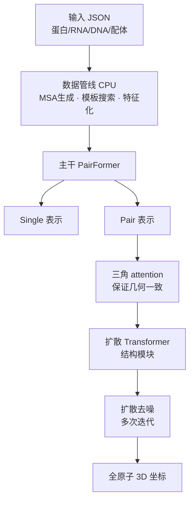
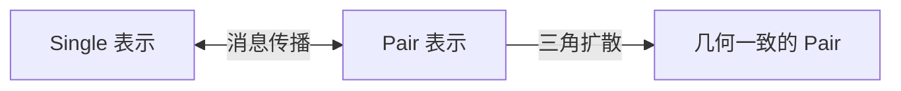

---


---

# AlphaFold 3 架构学习笔记

> [!info] 一句话定位
> AF3 是从"蛋白折叠"扩展到**全分子复合体**（蛋白/核酸/配体）结构预测的基础模型。核心创新是 **PairFormer（主干）→ 扩散 Transformer（结构模块）** 的两段式架构。

## 与相关概念的连接
- [[扩散模型]]
- [[Transformer]]
- [[AlphaFold 2]]
- [[SE(3) 等变]]
- [[VLA / 机器人控制]] （信息流→生成的范式可迁移）

---

## 1. 整体信息流



**数据管线（CPU 密集）与模型推理（GPU）可分离** —— 是超算优化的第一个切入点的 [[超算优化]]。

---

## 2. 输入与 token 化

- **输入 = 复合物 JSON**，支持：蛋白/RNA/DNA 链、CCD code / SMILES 定义的配体、链间共价键、自定义 MSA 与模板。
- **通用 token 化**：每个 token ≈ 一个可旋转刚性片段；氨基酸粒度可动态缩放（主链 backbone ↔ 全侧链原子）。
- 两套对象：
  - **token 级**（宏观）：Single / Pair 表示
  - **atom 级（微观）**：扩散输出全原子坐标

### 数据管线两阶段（重点）
1. 离线（CPU+高 RAM）：MSA 搜索 → 模板搜索 → 特征化 → 填充 JSON
2. 在线（GPU）：特征化 token → embedding → 主干 → 扩散模型

> [!tip] 超算优化点
> MSA 搜索可**只算一次并复用**（固定链场景），成对链时搜索从 O(n²) 降到 O(n)。

---

## 3. 主干网络：PairFormer

取代 AF2 的 Evoformer 核心。维护 **Single（点性）+ Pair（边性）** 双表示，持续互化：
- **Single → Pair**：线性投影更新关系
- **Pair → Single**：聚行信息更新自身
- **Pair 内部：三角扩散更新**



### 三个关键设计问题（本笔记的核心）

#### Q1: 如何联系 Single 和 Pair？
是**点/边耦合系统**：Single=点自身描述，Pair=两点间关系；两者反复互化，最终 pair 携带完整几何假设。

#### Q2: 为什么用三角 attention 保证几何一致？
为了内建**三角不等式**：`d(i,j) ≤ d(i,k)+d(k,j)`。
若 pair 矩阵自由，会出现 *A靠近B、B靠近C、但A远离C* 的物理上不可能的"几何打结"。三角扩散用行/列方向的注意力，通过第三方 k 共同推断 i-j，强制一致性。

#### Q3: 为什么作为 bias 传 Transformer？
Pair 表示已编码" i、j 该靠多近"（先验结构）。把它投影成标量，**加进 attention 注意力矩阵作为 bias**，让结构模块"听从"主干的几何假设：
```
Attention(Q,K,V) = softmax(QKᵀ/√d + bias(i,j))·V
                                     └─ Pair 投影
```
**优点**：先验注入不改变 Q/K/V 主表达流、N² 对齐省显存。

---

## 4. 扩散 Transformer（结构模块）

### 4.1 范式转变：回归 → 扩散
- AF2：回归式直接输出坐标 + InvariantPointAttention 硬编码 SE(3)。
- AF3：**扩散式**从噪声坐标逐步到清晰坐标。好处：**支持多峰构象**、架构更简单。代价：推理要多轮迭代。

### 4.2 扩散流程
- 正向（训练）：真值坐标 → 逐步加高斯噪声
- 逆向（推理，超算跑这个）：x_T 噪音 → 每步让 Transformer 预测去噪方向 → 组合步长 + 噪声 → 迭代 n 次收敛

```
x_{t-1} = 去噪(x_t, Single, Pair, 温度)
```
- **温度/噪声水平 σ**：早期大、步长大（盲搜）；后期小、步长小（精修细节）。

### 4.3 层结构
```
输入: Single S + Pair z + 当前坐标 x(线性嵌入)
 ┌──── DiffusionTransformerBlock ────┐
 │ (1) AtomCrossAttention (原子交叉)   │
 │ (2) PairAttention + bias           │
 │ (3) Linear / LayerNorm             │
 └─────────────────────────────────────┘
 重复 N 层 → 每 token 输出坐标偏移 δx
```

- **AtomCrossAttention**：为什么？坐标级关注关注的是原子位置而非 token，所以 token 对"其负责的原子"做交叉注意力。

### 4.4 SE(3) 为什么被抛弃？
- 坐标当普通特征直接处理，不再显式等变，靠**数据学习**。
- 商：何时用例先验强制对称，何时靠数据学 — 也是业界 & VLA 研究的开放问题。

### 4.5 输出端 DiffusionHead
- 把 token 位置更新映射回**全原子 3D 坐标**（拼 N、CA、C、O 等）
- 输出坐标 + 置信度（pLDDT）
- 这就是需要**动态 token 粒度**的原因。

---

## 5. 超算优化瞄准点

| 方向 | 机理 | 方法 |
|---|---|---|
| 去噪步数 n | 每步 1 次完整 Transformer 开销 | 少步 distillation / 提前停 |
| attention 精度 | Pair N² 爆内存 | bf16 / 低精度量化 |
| 多 GPU 切分 | 坐标特征全原子巨大 | N² attention 分卡、Memory-aware调度 |
| MSA 复用 | 数据管线昂贵 | 离线缓存、固定链重复用 |

---

## 6. 待深入

- [ ] AtomCrossAttention + PairAttention 一个 block 内的具体顺序实现
- [ ] DiffusionHead 从 token 恢复全原子坐标（动态 token 粒度落点）
- [ ] 训练损失（FAPE 等）如何定义"去噪成功"
- [ ] 与 [[VLA]] 的范式对照笔记
